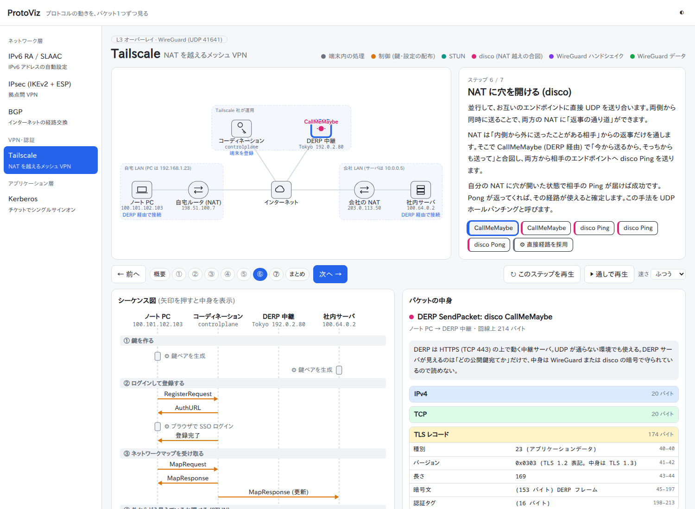

# ProtoViz

プロトコルの動きを「ステップごとのパケットの移動」「シーケンス図」「パケットのバイト単位の中身」で見せる、人に説明するための Web アプリ。
[Protocol Explorer](https://protocol-explorer-alpha.vercel.app/) に着想を得て、ARP・DHCP・IPv6 (ND, RA, DHCPv6)・IPsec・BGP・Tailscale・Kerberos・DoH・NTP などを日本語で作ったもの (コードは独自)。

**デモ: https://sasakipochi.github.io/protoviz/**



## 収録しているプロトコル

| ID | 内容 | ステップ |
|---|---|---|
| `arp` | ARP (経路表 → 要求 → 応答 → 通信 → Probe/Gratuitous ARP → ARP スプーフィング) | 6 |
| `rarp` | RARP (ディスクレス WS が IP を尋ねる → 表を引いて応答 → TFTP → なぜ廃れたか) | 5 |
| `nd` | IPv6 近隣探索 (要請ノードマルチキャスト → NS → NA → NUD → DAD で重複検出) | 5 |
| `ra` | IPv6 RA / SLAAC (DAD → RS → RA → アドレス生成 → 通信) | 5 |
| `dhcp` | DHCP (Discover → Offer → Request → Ack → Renew) | 5 |
| `dhcpv6` | DHCPv6 (RA の M フラグ → Solicit/Advertise/Request/Reply をリレー経由で) | 5 |
| `ipsec` | IPsec 拠点間 VPN (IKE_SA_INIT → IKE_AUTH → ESP → DPD) | 8 |
| `bgp` | BGP (TCP → OPEN → KEEPALIVE → UPDATE → 伝播 → 転送 → 取り下げ) | 7 |
| `tailscale` | Tailscale (登録 → ネットマップ → STUN → DERP 経由 → disco で NAT 越え → 直接 WireGuard) | 7 |
| `kerberos` | Kerberos (PREAUTH_REQUIRED → AS → TGS → AP-REQ/AP-REP over HTTP Negotiate) | 5 |
| `doh` | DoH (平文の DNS と比較 → TCP → TLS 1.3 → HTTP/2 POST /dns-query → 応答) | 6 |
| `ntp` | NTP (stratum の階層 → T1〜T4 → オフセットとディレイの計算 → slew) | 5 |

URL でプロトコルとステップを直接開ける: `http://protoviz.localhost/#/kerberos/2` (ステップは 0 始まり)。
キーボード: ← → でステップ移動、スペースで再生。

## 構成

```
site/                 静的サイト (ビルド不要。site/index.html をブラウザで開くだけでも動く)
  js/bytes.js         パケットの組み立て (Ethernet/IPv4/IPv6/UDP/TCP、ASN.1 DER)。長さとチェックサムは実際に計算
  js/engine.js        描画 (構成図・アニメーション・シーケンス図・インスペクタ)
  js/protocols/*.js   プロトコルごとのデータ (ノード・ステップ・パケット)
tools/                全パケットの長さ・チェックサム・DER 構造・IKE ペイロード連鎖などを別実装 (Python) で検証
chart/protoviz/       Helm チャート (nginx-unprivileged, Ingress は Traefik)
```

## 使い方

### Kubernetes に入れる

```sh
helm install protoviz oci://ghcr.io/sasakipochi/charts/protoviz -n protoviz --create-namespace \
  --set ingress.host=protoviz.example.com      # Ingress を使わないなら --set ingress.enabled=false
```

Ingress なしの場合は `kubectl -n protoviz port-forward svc/protoviz 8080:80` で http://localhost:8080/ 。
イメージは `ghcr.io/sasakipochi/protoviz` (nginx-unprivileged、非 root・読み取り専用ルートファイルシステム、amd64/arm64)。

### k8s なしで見る

静的ファイルだけなので、`site/index.html` をブラウザで開くか `make serve` (http://localhost:8000/) で動く。

### 開発

```sh
make check    # 全パケットの長さ・チェックサム・DER 構造を Python の別実装で検証
make          # 検証 → イメージ build/push (REGISTRY, 既定 localhost:5000) → helm でデプロイ
```

リリース: `chart/protoviz/Chart.yaml` の version / appVersion を上げてコミットし、同じ番号の `v*` タグを push すると、
GitHub Actions がイメージとチャートを ghcr.io に公開する。
デモサイト (GitHub Pages) は main に push すると `site/` の内容で自動更新される。

## プロトコルを追加するには

`site/js/protocols/` に1ファイル作って `PV.register({...})` を呼び、`site/index.html` に `<script>` を1行足す。
既存の `ra.js` (一番短い) が雛形になる。主な要素:

- `nodes` (座標は横 1000 の SVG 座標) と `links` — パケットはリンクをたどって最短経路で動く
- `lifelines` — シーケンス図に出すノード (パケットの送信元・宛先はこの中から)
- `steps[].events` — `PV.ev(from, to, 色, ラベル, パケット)` か `PV.local(ノード, ラベル, 説明)`。`to` を配列にするとマルチキャスト、`{ with: true }` で直前と同時に動く
- `steps[].state` — ノードの下に出す状態表示 (ステップを進めると積み上がる)
- パケットは `PV.pkt(要約)` に `PV.h.ipv4()` などで層を積み、`.u8/.u16/.u32/.f/.str/.blob` でフィールドを足す。
  `{ decoded: true }` の層は「復号・デコードした中身」として回線上のバイト列とは別に表示される
- 長さ付きの入れ子 (TLS の拡張、DHCP/DHCPv6 のオプションなど) は `PV.tlv.node(名前, 先頭バイト, 長さのバイト数, 子)` で組むと長さが自動で入る。
  ASN.1 DER は `PV.der`、DNS の名前は `PV.dnsName()`、ARP/RARP は `PV.h.arp()`
- `make check` がすべてのパケットの長さ・チェックサム・入れ子の構造を Python で検証する (`tools/verify_packets.py`)

アドレスは文書用の予約範囲を使い、暗号文・鍵は `PV.rand(seed, n)` で決定的に作った値。

## ライセンス

MIT
